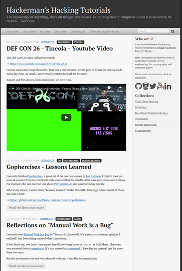
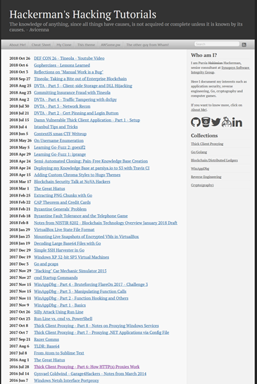

# Hugo-Octopress <!-- omit in toc -->
Hugo-Octopress is a port of the classic [Octopress][octopress-link] theme to
[Hugo][hugo-link].

Live demo using the unmodified theme:

* [http://hugo-octopress-test.s3-website-us-east-1.amazonaws.com/][live-demo].
* Source: [https://github.com/parsiya/Hugo-Octopress-Test][test-repo].

[live-demo]: http://hugo-octopress-test.s3-website-us-east-1.amazonaws.com/
[test-repo]: https://github.com/parsiya/Hugo-Octopress-Test

My personal website with the compact index (see below):

* [https://parsiya.net](https://parsiya.net).
* Source: [https://github.com/parsiya/parsiya.net](https://github.com/parsiya/parsiya.net)

## Contents <!-- omit in toc -->
- [Quick start](#quick-start)
- [Configuration](#configuration)
- [Languages and text direction](#languages-and-text-direction)
  - [RTL and mixed-language text](#rtl-and-mixed-language-text)
- [Tests](#tests)
- [Code highlight](#code-highlight)
- [Goldmark vs. Blackfriday Markdown Engines](#goldmark-vs-blackfriday-markdown-engines)
- [CSS override](#css-override)
- [Navigation menu](#navigation-menu)
- [Extending Headers and Footers](#extending-headers-and-footers)
- [Sidebar](#sidebar)
  - [Sidebar text](#sidebar-text)
  - [Social network icons](#social-network-icons)
  - [Sidebar menu](#sidebar-menu)
  - [Recent posts](#recent-posts)
- [Pages](#pages)
  - [License page](#license-page)
  - [Not Found or 404.html](#not-found-or-404html)
  - [Taxonomy pages](#taxonomy-pages)
  - [Individual pages](#individual-pages)
- [Table of contents](#table-of-contents)
  - [toc configuration](#toc-configuration)
  - [Use toc in Frontmatter](#use-toc-in-frontmatter)
  - [Use the toc Shortcode](#use-the-toc-shortcode)
  - [Editor Plugins](#editor-plugins)
- [Disqus](#disqus)
- [Twitter Card](#twitter-card)
- [Compact Index](#compact-index)
- [mainSections](#mainsections)
- [Custom favicon](#custom-favicon)
- [Troubleshooting](#troubleshooting)
  - [Hugo page summary bug](#hugo-page-summary-bug)
  - [Empty Posts Link on Homepage](#empty-posts-link-on-homepage)
- [Attribution](#attribution)
- [Ported by](#ported-by)
- [Theme license](#theme-license)


## Quick start
Requires Hugo `0.168.0` or newer.

Add the theme to your existing site or [Hugo's quick start][hugo-quickstart].
All commands are run from the root directory of your website.

[hugo-quickstart]: https://gohugo.io/getting-started/quick-start/

If using git to manage your website, add the theme as a git submodule:

```
git submodule add https://github.com/parsiya/Hugo-Octopress themes/Hugo-Octopress
```

Or you can clone it:

```
git clone https://github.com/parsiya/Hugo-Octopress themes/Hugo-Octopress
```

To view the theme with the example site:

```
cd themes/Hugo-Octopress/
hugo server --source=exampleSite
```

And view the example website at http://localhost:1313.

Example site was originally created by
[https://github.com/nonumeros][nonumeros]. I reviewed the
[pull request][examplesite-pr] almost two years late and had to copy/paste the
website instead of resolving merge conflicts. The example website also has a
page with the theme's shortcodes.

[nonumeros]: https://github.com/nonumeros
[examplesite-pr]: https://github.com/parsiya/Hugo-Octopress/pull/57

## Configuration
Hugo-Octopress can be configured by modifying the parameters in the
[configuration file](https://gohugo.io/overview/configuration/). 
[sample-config.toml](sample-config.toml) and
[exampleSite/config.toml](exampleSite/config.toml) are both working examples.

## Languages and text direction
Set each language's locale, label, and direction:

```toml
defaultContentLanguage = "en"

[languages.en]
  locale = "en-US"
  label = "English"
  direction = "ltr"

[languages.fa]
  locale = "fa-IR"
  label = "فارسی"
  direction = "rtl"

[[languages.en.menus.main]]
  name = "Home"
  pageRef = "/"

[[languages.fa.menus.main]]
  name = "خانه"
  pageRef = "/"
```

Name translated files `post/example.en.md` and `post/example.fa.md`. The
language switcher links to existing translations. Prefer `pageRef` for internal
menus; custom internal URLs are relative to the current language.

English/Persian interface labels are included. Missing translations first use
Hugo's configured default language, then the theme's English fallback. Add
dictionaries under your site's `i18n/`, using the theme's `i18n/en.yaml` keys.
Configured labels such as `continueReadingText` still override defaults.

RTL mirrors layout, not fonts, calendars, or digits. Dates remain Gregorian.
Choose fonts through custom CSS; site overrides and embeds may need RTL styling.

[Vazirmatn][vazir] `v33.003` regular/bold
fonts are bundled and loaded automatically, independent of `direction` and
`disableGoogleFonts`. Only Arabic-script glyphs use Vazirmatn; English and code
fonts remain unchanged. Files are served locally, with no font CDN dependency or
extra configuration.

[vazir]: https://rastikerdar.github.io/vazirmatn/

### RTL and mixed-language text
Use `bidi` for a phrase, including punctuation belonging to it:

````markdown
نسخه C++ (v1.2) آماده است.
````

Use `direction` for paragraphs or whole lists. This puts English bullets on the
left while keeping the Persian note RTL:

````markdown

* https://example.org/first
* https://example.org/second (توضیح فارسی)

````

Both shortcodes support Markdown, nesting, optional `lang`, and
`dir="ltr|rtl|auto"` (`auto` is the default). Use ``, not `{}`.
Prefer an explicit direction: `auto` misreads a Persian sentence starting with
`HTTP`. Leave Persian lists RTL; `lang` alone does not set direction.

Single-backtick code such as `` `curl -I` `` is isolated LTR in paragraphs,
lists, headings, and table cells, as are triple-backtick fenced blocks. Code
punctuation stays with the code; surrounding prose keeps its own direction.

Copy/paste commands and URLs into a plain-text editor to check their characters.
More cases: [Bidirectional Text example](exampleSite/content/post/bidirectional-text/index.md).

## Tests
From the theme root, with Node.js `20.12.0` or newer:

```sh
npm ci --prefix tests
npm test --prefix tests
```

Tests use `exampleSite` fixtures and fail on Hugo warnings. See
[the testing guide](ai-docs/testing.md) for coverage and browser checks.

## Code highlight
This theme uses the built-in [Chroma][chroma-link] highlighter with the
`solarized-dark` theme. See all supported styles at
[https://xyproto.github.io/splash/docs/all.html](https://xyproto.github.io/splash/docs/all.html).
To change the style, change it in the config file like below to one of the
supported styles.

[chroma-link]: https://github.com/alecthomas/chroma

Some options to control code highlighting post version `0.60`.

``` toml
[markup]
  [markup.tableOfContents]
    endLevel = 8
    startLevel = 1
  [markup.highlight]
    style = "solarized-dark"
```

For more configuration options please see
[https://gohugo.io/getting-started/configuration-markup/#highlight][hugo-configuration-markup]
and [https://gohugo.io/extras/highlighting/][hugo-syntax-highlighting] in Hugo's
documentation.

[hugo-syntax-highlighting]: https://gohugo.io/extras/highlighting/
[hugo-configuration-markup]: https://gohugo.io/getting-started/configuration-markup/#highlight

## Goldmark vs. Blackfriday Markdown Engines
Prior to version `0.60`, Hugo used Blackfriday. Now it uses Goldmark by default.
See https://gohugo.io/getting-started/configuration-markup#highlight for
information about setting it up.

There are trade-offs. Mainly, the `hrefTargetBlank` Blackfriday extension. It
was set to true to open external links in a new browser tab. Unfortunately,
Goldmark does not have this built-in. To make it happen, we need to use a render
hook. I used the one in Hugo docs at

https://gohugo.io/getting-started/configuration-markup#link-with-title-markdown-example.

This works for markdown links but not linkify or image links. Linkify links are
straight URLs pasted into the document (e.g., `https://example.net`). A
workaround is not having links similar to this (which is not in the markdown
standard anyways) and use normal links. For example,
`[example.net](https://example.net)` or reference links.

You can keep using Blackfriday like this:

``` toml
[markup]
  defaultMarkdownHandler = "blackfriday"
  [markup.blackFriday]
    hrefTargetBlank = true
```

## CSS override
You can override the built-in CSS and add your own. Put your CSS files in the
`static` directory of your website. While storing them inside the
`themes/Hugo-Octopress/static` directory works, it's not recommended (keep your
website and theme as separated as possible to be able to switch themes easily).
Then modify the `customCSS` parameter. The path should be relative to the
`static` folder. These CSS files will be added through the `header` partial
after the built-in CSS file.

For example, if custom CSS files are `static/css/custom.css` and
`static/css/custom2.css` then `customCSS` will look like this:

``` toml
[params]
  customCSS = ["css/custom.css","css/custom2.css"]
```

## Navigation menu
Links in the navigation menu (everything other than Google search and RSS icon)
can be customized. The navigation menu is generated using the
`layouts/partials/navigation.html` partial.

By default, navigation menu links will open in the same window. You can change
this behavior by setting the `navigationNewWindow` parameter to true. Links to
root ("/") will always open in the same window. Currently, Hugo does not support
adding custom attributes to menus.

Links are sorted according to weight from left to right. For example, a link
with weight of `-10` will appear to the left of links with weights `0` or `10`.
Links can be added to the config file:

``` toml
[[menu.main]]
  Name = "Blog"
  URL = "/"
  weight = -10

[[menu.main]]
  Name = "The other guy from Wham!"
  URL = "https://www.google.com/search?q=andrew+ridgeley"
  weight = -5

[[menu.main]]
  Name = "This theme - add link"
  URL = "https://www.github.com"

[params]
  # If set to true, navigation menu links will open in a new window with the exception of links to root ("/")
  # If this item does not exist or is set to false, then navigation menu links will open in the same window
  navigationNewWindow = true
```

Search engine customization:

``` toml
[params]
  searchEngineURL = "https://www.google.com/search"
```

## Extending Headers and Footers
Copy these files from `theme/Hugo-Octopress/layouts/partials/` into
`your-site/layouts/partials` and modify them:

* `extend_header.html`: Everything will be added to the end of the `head` tag on
  every page.
* `extend_footer.html`: Everything will be added after the `footer` tag on every
  page.

## Sidebar
The sidebar has four sections, from top to bottom:

* Sidebar header and text (optional).
* Social network icons (optional): Icons and links to GitHub, Mastodon, and more.
* Sidebar menu (optional): Links in sidebar.
* Recent posts: Displays last X posts (default is 5).

The sidebar is generated using the partial at `layouts/partials/sidebar.html`.

The sidebar is on the right by default, including in RTL languages. Set
`sidebarPosition` under `[params]` to `"left"` to move it to the left, or
`"right"` to keep it on the right:

```toml
[params]
  sidebarPosition = "left"
```

This setting uses physical left and right, regardless of text direction. Below
768px, the sidebar stays below the content on either setting. Values are
case-insensitive.

### Sidebar text
The sidebar text has two parts and both can be configured. Both are passed to
`markdownify` so you can use markdown (e.g. add links or new lines).

* Sidebar header appears first in an `<h1>` tag. It can be configured with
  `sidebarHeader`.
* Sidebar text appears under the header and is in `sidebarText`.

You can add new lines can be added with two spaces at the end of line. New
paragraphs can be added with two an empty line. when adding two new lines,
remember to remove the indentation otherwise the new line will be treated as a
codeblock.

``` toml
sidebarHeader = "Sidebar Header"

sidebarText = """Here's a [link to google](https://www.google.com)

New paragraph

Another paragraph which has two spaces in the end to create a new line using markdown  
New line but not a new paragraph
"""
```
  
If you want to use `</br>` here and not just markdown, you need to enable unsafe
rendering of HTML in Goldmark. You can do this like this.

``` toml
[markup]
  [markup.goldmark]
    [markup.goldmark.renderer]
      unsafe = true
```

Blackfriday renders the `</br>` tags and does not need extra configuration.

### Social network icons
Sidebar social network icons are configured as follows:

``` toml
[params]
  github = "https://github.com/parsiya/Hugo-Octopress/"
  bitbucket = ""
  gitlab = ""
  twitter = ""
  keybase = ""
  linkedin = ""
  mastodon = ""
  stackoverflow = ""
  youtube = ""
  facebook = ""
  instagram = ""
  bitcoin = ""
```

Icon sequence is unfortunately hardcoded. To modify, copy
`your-website/themes/Hugo-Octopress/layouts/partials/social.html` to
`your-website/layouts/partials/social.html` and modify the sequence. Use `</br>`
to create a new line.

Code to display links (and the idea to use these icons) is from
[Hyde-x][hyde-x-theme].

[hyde-x-theme]: https://github.com/zyro/hyde-x/

Icons are from [Font Awesome][font-awesome] and [Fork Awesome][fork-awesome]. To
use icons with square dark backgrounds add `-square`. For example,
`<i class="fa fa-twitter-square fa-3x"></i>`. Size can be from 1 to 5 use
`fa-lg` to make them adaptive.

[font-awesome]: https://fontawesome.com/
[fork-awesome]: https://github.com/ForkAwesome/Fork-Awesome

### Sidebar menu
This menu can be enabled by setting `sidebarMenuEnabled` to `true`. It has two
sections:

* A header that appears inside the `<h1>` tag on top. It can be set by
  `sidebarMenuHeader`. This part only supports text.
* A set of links. They can be configured similar to the navigation menu items by
  using the `[[menu.sidebar]]` tag. Set `sidebarNewWindow` to `true` to open
  these links in a new window

``` toml
[[menu.sidebar]]
  Name = "Google"
  URL = "https://www.google.com"
  weight = 0

[[menu.sidebar]]
  Name = "Hugo"
  URL = "/categories/hugo/"
  weight = 1
```

### Recent posts
Last x posts can be displayed in the sidebar. This number is controlled by
`sidebarRecentLimit`. To hide this section you can remove `sidebarRecentLimit`
from the config file or set it to zero.

## Shortcodes
Creating [shortcodes][hugo-shortcodes] in Hugo is very easy and one of the
reasons I switched to it. I recreated a few plugins from Octopress. They add
captions to code blocks and images. These shortcodes are in
`layouts/shortcodes/`.

For all my Hugo shortcodes see
[https://github.com/parsiya/Hugo-Shortcodes][my-shortcodes].

[hugo-shortcodes]: https://gohugo.io/extras/shortcodes
[my-shortcodes]: https://github.com/parsiya/Hugo-Shortcode

## Pages
This section discusses the different kind of pages that are supported by the
theme.

### License page
License page address is `baseurl/license/`. Create a markdown file containing
the text for the license page under `content` and set its type to `license` in
frontmatter:

``` yaml
---
title: "License"
type: license
---

License text
```

License page template is: `layouts/license/single.html`.

### Not Found or 404.html
The `404.html` page has two optional parameters and both support markdown:

* `notFoundHeader`: 404 page title
* `notFoundText`: 404 page text

If they are not set in the config file, theme's default page is used
(`layouts/404.html`).

### Taxonomy pages
You can create taxonomy lists (e.g. categories and tags). Set
`generateTaxonomyList = true` to get generate them at `baseURL/tags/` and
`baseURL/categories`. By default items are sorted by count.
`sortTaxonomyAlphabetical = true` changes the sort to alphabetical.

``` toml
[Params]
  generateTaxonomyList = true

  # Alphabetical sort
  # sortTaxonomyAlphabetical = true
```

To revert, remove `sortTaxonomyAlphabetical` or set it to false.

Note: As of Hugo 0.33, `indexes` has been removed. If your taxonomy pages are
not rendered, please update to the latest version of Hugo. Templates are now at:

* `/layouts/category/category.html`
* `/layouts/tag/tag.html`

### Individual pages
You can create individual pages in at least two ways:

* Create a new content file in `content/page`.
* Create a page anywhere inside `content` and set the type to `page` in
  frontmatter. E.g. `type: page`.

The template for individual pages is at
`Hugo-Octopress/layouts/page/single.html`. It can be overridden by a file in the
website's `layouts/page/single.html`. For more information see
[Single Page Templates in Hugodocs][hugo-single-page-templates].

[hugo-single-page-templates]: https://gohugo.io/templates/single-page-templates/

## Table of contents
There are three ways to add `Table of Contents (ToC)` to pages.

### toc configuration
With Goldmark, you need to change the defaults for the table of contents
renderer in your site's config. The defaults only render markdown headings level
2 and 3.

``` toml
[markup]
  [markup.tableOfContents]
    endLevel = 8
    startLevel = 1
```

Please see more at
[https://gohugo.io/getting-started/configuration-markup/#table-of-contents][toc-config].

[toc-config]: https://gohugo.io/getting-started/configuration-markup/#table-of-contents

### Use toc in Frontmatter
This ToC is on top of the page and does not appear in the summary. You can
customize the ToC for each page or globally:

1. Add a variable named  `toc` to the frontmatter of the post/page and set it to `true`.

    ``` yaml
    title: "title"
    date: 2016-04-01T20:22:37-04:00
    draft: false
    toc: true
    ```

2. Enable it globally by setting `tableOfContents` under `[Params]` to `true`.

    ``` toml
    [Params]
      tableOfContents = true
    ```

The `toc` variable in the frontmatter has priority. If it is set to `false` the
global setting is ignored for that page.

### Use the toc Shortcode
If you want the table to appear in a different location use the shortcode.

```
---
frontmatter
---

summary or whatever.


```

### Editor Plugins
There are various editor plugins that create a table of contents in markdown
using markdown links. This approach is self-contained and not reliant on the
theme or the shortcode. I used the VS Code plugins
[Markdown All in One][markdown-vscode-toc].

[markdown-vscode-toc]: https://github.com/yzhang-gh/vscode-markdown#table-of-contents

## Disqus
Hugo supports Disqus. Note Disqus shortname is directly in the config file. As
of at least v0.134.0, the location has changed and this old one will be
deprecated in a bit. For now, (before v0.135.0), the theme still supports this
location, but you should switch it if you want to keep using the latest Hugo
versions.

Reference: https://gohugo.io/content-management/comments/#configure-disqus.

``` toml
# new location
# [services]
#  [services.disqus]
#    shortname = "Your disqus shortname"

# old one.
disqusShortname = "whatever"
```

You can disable comments for individual pages by adding `comments: false` to
the frontmatter.

## Twitter Card
Twitter card support can be enabled in the config file under `Params`:

``` toml
[params]
  # Twitter card config
  # Enable.
  twitterCardEnabled = true
  # Don't include the @.
  # twitterCardSite = 
  twitterCardDomain = "parsiya.net"
  # Don't include the @.
  twitterCardAuthor = "CryptoGangsta"
```

After Twitter card is enabled, you can add summary images to your posts in front
matter with `twitterImage`:

``` yaml
twitterImage: 02-fuzzer-crash.png
```

**Note:** Image URL should be relative to the page, otherwise the final URL will
not be correct. In short, image URL should be part of the page bundle. In this
case, both `index.md` and `02-fuzzer-crash.png` are in the same root directory.
If the image is in a subdirectory of page bundle, it can be added like this:

``` yaml
twitterImage: images/02-fuzzer-crash.png
```

To modify this template, copy
`your-website/themes/Hugo-Octopress/layouts/partials/custom_twitter_card.html`
to `your-website/layouts/partials/custom-twitter-card.html` and make changes.

## Compact Index
The original theme renders each post's summary in the main page. I prefer a more
compact index and use it for my own website. You can enable it by adding this to
the config file:

``` toml
[params]
  # Set to true to enable compact index. Set to false or remove to go back to classic view.
  compactIndex = true
```

Compare the views (classic - compact) - click for full-size image:

[](https://raw.githubusercontent.com/parsiya/Hugo-Octopress/master/images/classicindex.png) [](https://raw.githubusercontent.com/parsiya/Hugo-Octopress/master/images/compactindex.png)

## mainSections
Hugo-Octopress supports using the [mainSections][hugo-mainsections] property in
the config file to display different kinds of posts on the main page. If not
defined, `mainSection` will default to the section with the most number of
pages. In a vanilla Hugo-Octopress setup, it will be under `post`. But, you can
add your own sections in the config file:

```toml
[params]
  mainSections = ["posts", "blogs"]
```

[hugo-mainsections]: https://gohugo.io/functions/where/#mainsections

See the code in `layouts/partials/classic_index.html`:

```html
<div class="blog-index">
  {{ $paginator := where site.RegularPages "Type" "in" site.Params.mainSections | .Paginate }}
  {{ range $paginator.Pages }}
  <article>
  ...
```

## Custom Favicon
The theme uses the [default Octopress favicon](static/favicon.png). You can
modify it:

1. Add `favicon` to the config file under `params`. This path is relative to the
   `static` directory.  
   ```toml
   [params]
     favicon = "myicon.png"
   ```
2. Store the file in **your site's** static directory:
   `your-site/static/myicon.png`.

# Troubleshooting
Common issues when dealing with the theme.

## Hugo page summary bug
Without a summary divider `<!--more-->`, Hugo uses the first 70 words of the
post. The result is usually not pretty and contains raw HTML. Always use the
summary divider `<!--more-->` in your posts. This does not matter if you
use the compact index because it does not use the summary.

Hugo does not display render style links in the page summary if the link is also
not before the summary divider. You can read more
[here](https://discuss.gohugo.io/t/markdown-content-renders-as-regular-text-in-summary/1396/12).

Reference style links look like this:

``` markdown
This is a link to [Example][example-link].

[example-link]: https://www.example.com
```

There are two workarounds:

1. Do not use reference style links in summary. Use normal links like `[Example](https://www.example.com)`.
2. Put the reference links before the summary divider.

### Empty Posts Link on Homepage
After rebuilding the blog with Hugo `0.57`, you may see a single `Posts` link in
the classic index. Update to Hugo `0.57.2+` (there is an issue with `0.57.1`)
and it should work.

For more information please see:

* https://github.com/gohugoio/hugoThemes/issues/682

This should not be an issue anymore because the theme's minimum version of Hugo
has been bumped.

## Attribution
* [Octopress][octopress-link] is created by [Brandon Mathis][mathis-link].
  Octopress source can be found on
  [https://github.com/imathis/octopress][octopress-github].
* Some code was taken from the [Hyde-x][hyde-x-theme] Hugo theme by [Andrei Mihu][andrei-mihu-link].
* Sidebar icons are from [Font Awesome][font-awesome] by Dave Gandy and [Fork Awesome][fork-awesome].
* Special thanks to [contributors][theme-contributors] and everyone who has
  helped with issues.

[octopress-github]: https://github.com/octopress/octopress
[mathis-link]: https://github.com/imathis
[theme-contributors]: https://github.com/parsiya/Hugo-Octopress/graphs/contributors
[andrei-mihu-link]: http://andreimihu.com/

## Ported by
Ported by [Parsia](https://parsiya.net).

## Theme license
Theme code uses the [MIT license](LICENSE.md). Bundled Vazirmatn fonts retain
their copyright and [SIL Open Font License 1.1](static/fonts/vazirmatn/OFL.txt),
which permits bundling with software but not selling the fonts by themselves.

<!-- Links -->
[octopress-link]: http://octopress.org
[hugo-link]: https://gohugo.io
